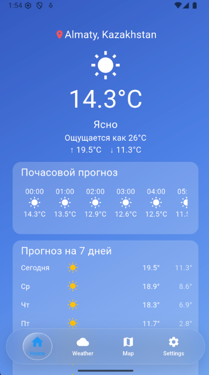

# 🌤 WeatherApp

A mobile weather forecast application built with **Flutter** and **Dart**.

A student pet project created to practice mobile app development.

## 📱 About the Project

WeatherApp displays current weather conditions and forecasts for the upcoming days.

The project was created to practice:

- Working with REST APIs
- Making HTTP requests
- Parsing JSON responses
- Building Flutter UI
- Managing application state

## ✨ Features

- Current temperature and weather conditions
- 7-day weather forecast
- Weather data fetched from an API
- UI for Android and iOS

## 🛠 Tech Stack

- [Flutter](https://flutter.dev/)
- [Dart](https://dart.dev/)
- [Dio](https://pub.dev/packages/dio) — HTTP client
- [Open-Meteo](https://open-meteo.com/) — weather API

## 📸 Screenshots



## 🚀 Getting Started

### Prerequisites

- Flutter SDK
- Dart SDK
- Android Studio or VS Code

### Installation

1. Clone the repository:

   ```bash
   git clone https://github.com/ayazz91/WeatherApp.git
   ```

2. Navigate to the project directory:

   ```bash
   cd WeatherApp
   ```

3. Install dependencies:

   ```bash
   flutter pub get
   ```

4. Run the application:

   ```bash
   flutter run
   ```

## 📂 Project Structure

```text
lib/          # Application source code
test/         # Tests
android/      # Android platform files
ios/          # iOS platform files
screenshots/  # Application screenshots
```

## 🗺 Roadmap

- [ ] Dark theme
- [ ] Favorite cities
- [Y] Hourly forecast
- [ ] Offline data caching
- [ ] Automated tests

## 👤 Author

[ayazz91](https://github.com/ayazz91)
